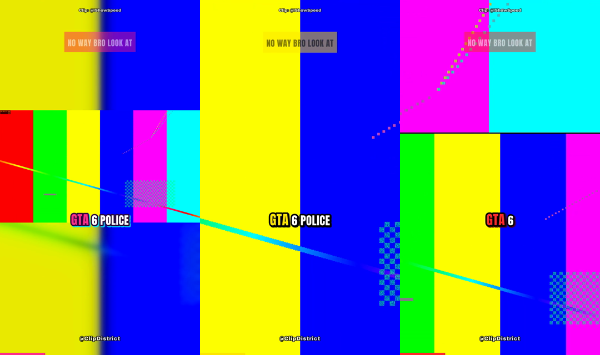

# ClipDistrict Studio

Turn GTA 6 streams into ready-to-post YouTube Shorts.

Paste a stream link → the app downloads it, writes subtitles, finds the best moments (hype words + loud reactions), and lets you style each Short with animated captions before uploading it to your channel.

Everything runs on your own computer. No paid AI API is needed.



## Run it free in the cloud (nothing to install)

[](https://colab.research.google.com/github/eyasahbeni/clipdistrict-studio/blob/main/ClipDistrict_Colab.ipynb)

Click the badge → **Runtime → Change runtime type → T4 GPU** → **Runtime → Run all** → click **👉 Open ClipDistrict Studio**.
Download your Shorts with step 4 before closing (or tick *Save to Google Drive*).

## What it does

| Step | What happens |
|---|---|
| **Import** | Paste a YouTube / Twitch / Kick link, or drop a video file. Choose just a part of a long stream with *Only from / To*. |
| **Subtitles** | Speech is transcribed locally with Whisper (free, offline after the first download). You can also drop your own `.srt`. |
| **Best moments** | Each moment gets a score and a reason: hype words ("no way", "GTA 6", "police chase"), **your own keywords** (Settings), screaming / loud reactions, fast talking. Clips start right on the first word. |
| **Search the stream** | Type what the streamer says ("police chase, lucia") and jump to every time he said it → **+ Make clip**. |
| **Edit** | Live 9:16 preview. Trim, pick a caption theme, layout, caption position/size, words per line, hook title, channel tag and credit line. |
| **Render** | 1080×1920 MP4 with word-by-word animated captions, hook title, progress bar and loudness boost. Render one or all moments. |
| **Upload** | Title ideas, auto description with credit + hashtags, private / unlisted / public. Uses Google's official sign-in. |

**16 caption themes:** Vice City · Hype Yellow · Wanted Level · Neon Money · Leonida Sunset · Ice Cold · Clean White · Box Pop · Breaking News · Neon Glow · Cyber Glow · Karaoke Fill · Type Reveal · One Word Punch · Hype Tilt · Minimal
**Layouts:** full frame + blurred background · fill screen (crop) · facecam top + gameplay bottom

## Autopilot (runs by itself)

Open the **Autopilot** tab.

1. **Watchlist** – add creators who allow clipping (`@IShowSpeed`). Every 30 min the app checks their channel for new videos with "GTA 6" in the title.
2. **Import** – it downloads the new video (only the first 4 hours of very long streams, you can change it) and writes subtitles.
3. **Pick** – it scores every moment with your keywords + hype and keeps the best ones above your minimum score.
4. **Render** – with your Autopilot theme and layout, hook title, channel tag and credit.
5. **Post** – uploads to the channel you picked (or waits for you to check, your choice).
6. **Clean** – deletes the big downloaded video, keeps the Shorts. Old videos are deleted automatically after N days.

The app (and PC) must stay on for this to work. Everything is logged in **Activity**.

> **Important:** Google keeps videos uploaded by a new, unverified API project **private** until the project passes the free [YouTube API audit](https://support.google.com/youtube/contact/yt_api_form). Until then, set *After rendering* to "Don't upload" and post the finished Shorts yourself from YouTube Studio or the YouTube app. A project gets 100 uploads per day.

You can connect **several channels** in Settings and pick which one each Short (or Autopilot) posts to.

## Start it (Windows)

1. Install **Python 3.11+** from [python.org](https://www.python.org/downloads/). Tick **"Add python.exe to PATH"**.
2. Download this repo (Code → Download ZIP) and unzip it.
3. Double-click **`start.bat`**.

The first start takes a few minutes: it installs everything (including FFmpeg) and opens the app at `http://127.0.0.1:8765`. After that it starts in seconds. The first transcription also downloads the Whisper model once (~500 MB for "small").

macOS / Linux: run `./start.sh`.

## Connect YouTube (one time, free)

Open **Settings** (⚙ top right) in the app.

**Search key** (optional, lets you search GTA 6 streams inside the app)
1. Go to [console.cloud.google.com](https://console.cloud.google.com) → create a project.
2. *APIs & Services → Library* → enable **YouTube Data API v3**.
3. *Credentials → Create credentials → API key*. Paste it in Settings.

**Uploading to your channel**
1. *APIs & Services → OAuth consent screen* → External → fill the app name and your email → add your Gmail as a **test user**.
2. *Credentials → Create credentials → OAuth client ID* → type **Desktop app** → download the JSON.
3. In Settings, choose that JSON, then click **Sign in with Google** and pick the ClipDistrict channel.

## Host it online (Hugging Face Spaces)

1. On huggingface.co → **New Space** → SDK **Docker** → Blank → choose **Private**.
2. Upload the files from `clipdistrict-hf-space.zip` (or this repo with `deploy/huggingface/README.md` as the root `README.md`).
3. In the Space **Settings → Variables and secrets** add: `APP_PASSWORD`, `SECRET_KEY`, `YOUTUBE_API_KEY`, `GOOGLE_OAUTH_CLIENT_JSON`.
4. For uploading, create a Google OAuth client of type **Web application** with redirect URI `https://<your-space>.hf.space/oauth/callback`.
5. Open `https://<your-space>.hf.space` directly (not inside the huggingface.co page) and log in.

Free Spaces lose files when they restart and go to sleep when unused, so Autopilot only runs while the Space is awake. Add persistent storage or move to a VPS for 24/7. YouTube may block downloads from server IPs.

Any VPS works the same: `docker build -t clipdistrict . && docker run -p 7860:7860 -e APP_PASSWORD=… -e PUBLIC_URL=https://your-domain clipdistrict`.

## Tips

- **Long streams:** import only the part you want (e.g. from `1:20:00` to `1:45:00`). Downloading and transcribing a 4-hour stream takes a long time.
- **Subtitle quality** (Settings): *Fast* for quick tests, *Balanced* for normal use, *Best* if you have a strong PC.
- **Facecam layout:** pick the corner where the streamer's camera is, then adjust *Facecam size* until only the face shows.
- Shorts must be **60 seconds or less** to count as Shorts on most accounts.
- If link import breaks, close the app and run `start.bat` again. It updates the downloader automatically.

## Permission

Only clip creators who allow it (a public "feel free to clip" policy or a clipping program), and keep proof. Credit the creator; the app adds a credit line and source link for you. Downloading from YouTube is against YouTube's Terms of Service even with the creator's permission, so link import may sometimes stop working. Uploads go through Google's official API.

## For developers

```
python -m pip install -r requirements.txt
python -m clipdistrict app           # web app
python -m unittest discover -s tests # tests
```

Code map: `server.py` (API + jobs), `importer.py` (yt-dlp), `transcribe.py` (faster-whisper), `moments.py` (scoring), `captions.py` (ASS themes), `render.py` (FFmpeg layouts), `uploader.py` (YouTube OAuth), `web/` (UI). The original CLI still works: `python -m clipdistrict --help`.

Fonts: Anton and Archivo Black (SIL Open Font License, included in `clipdistrict/fonts`). MIT licensed.
